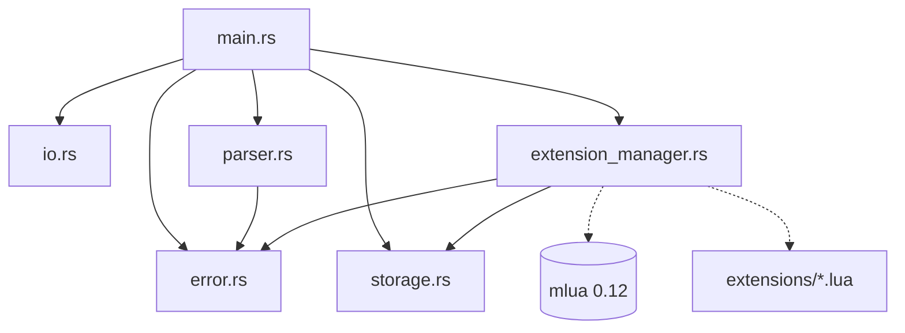

# EP 1 - Database: Rust + Lua

This repository contains the code for an in-memory key-value database written
in **Rust**, with extensions/plugins in **Lua**.

The Rust engine is agnostic to specific rules. All validations, formatting,
and additional data queries during execution are managed by the extensions
contained in the `extensions/` folder, loaded dynamically at CLI startup.

## How to Build and Run

### Requirements

- [Rust](https://www.rust-lang.org/).

### Building

At the repository root, run:

```bash
cargo build --release
```

The optimized executable will be generated at `./target/release/banco-memoria`.

### Interactive Execution

To open the interactive interface:

```bash
cargo run --release
```

Or by directly running the previously compiled binary:

```bash
./target/release/banco-memoria
```

**Interactive usage example:**

```text
$ ./target/release/banco-memoria
> ADD cpf_joe 12345678909
OK
> GET cpf_joe
123.456.789-09
> GET nonexistent_key
ERROR: key not found
> EXIT
$
```

### Execution via _Pipe_

The CLI detects whether input comes from an interactive terminal or a _pipe_.
When run via _pipe_, the `> ` prompt is omitted, but all responses
(`OK`, queried values, and error messages) are still emitted,
with the process exiting on end-of-file (EOF):

```bash
cat command-list.txt | ./target/release/banco-memoria
```

## How to Add an Extension

The system automatically discovers extensions in the `extensions/` directory at startup.

Extensions are simply `.lua` files that must return a table with
the following fields:

```lua
return {
    -- Key prefix the extension will monitor (optional)
    -- If not provided, the file name is used by default + `_`
    -- e.g.: extensions/somename.lua -> prefix = "somename_"
    prefix = "myprefix_",

    -- Function executed before the database operation (optional)
    pre_hook = function(ctx)
        -- ...
    end,

    -- Function executed after the database operation (optional)
    post_hook = function(ctx)
        -- ...
    end,
}
```

### The Context Object (`ctx`)

Both `pre_hook` and `post_hook` receive a context object (`ctx`), which
is a Lua table with the following fields and methods:

| Field / Method            | Type       | Mutable | Description                                                                                                              |
| ------------------------- | ---------- | ------- | ------------------------------------------------------------------------------------------------------------------------ |
| `ctx.command`             | `string`   | ❌      | Name of the running command (`"ADD"` or `"GET"`).                                                                       |
| `ctx.key`                 | `string`   | ❌      | Key provided by the user in the operation.                                                                               |
| `ctx.value`               | `string`   | ✅      | Value passed by the user for writing (present only in `ADD`). Can be changed by the extension.                           |
| `ctx.result`              | `string`   | ✅      | Value returned from the database (present in `GET`). Can be changed by the extension.                                    |
| `ctx.get(key)`            | `function` | ❌      | **Lookup by key**: queries the database in real time and returns the value of `key` (or `nil` if it does not exist).     |
| `ctx.get_key_by_value(val)` | `function` | ❌    | **Reverse lookup**: queries the database in real time and returns the key holding the value `val` (or `nil` if none).    |

### What the Rust application expects back

The extension is free to use field mutability as it wishes (e.g.:
changing the value before it is persisted to the database, formatting or transforming data
before it is displayed to the user, etc.).

1. **On Success**:
   - In `pre_hook`: The engine reads `ctx.value`. If the extension changed this field, the
     new value is what will actually be persisted to the database.
   - In `post_hook`: The engine reads `ctx.result`. If changed by the extension, the new
     value is what will be displayed to the user on screen.
2. **On Error**:
   - If the data is invalid or a business rule is violated, the
     extension must invoke `error("reason")`.
   - The Rust engine intercepts the Lua error, displays a single line on screen in
     the format `ERROR: {reason}` and the operation is aborted (i.e., if the error
     is raised in `pre_hook`, nothing is changed in the database).

## Database Querying from the Extension and Concurrency Resolution in `ADD`

The EP statement poses the following challenge:

> _"At the moment the extension asks the question, the ADD command is already in the middle
> of an operation on that same database. Solving this is part of the exercise."_

The adopted solution is based on:

1. **Reference-Counted Sharing with Interior Mutability**:
   - The single [`Storage`](src/storage.rs) instance is wrapped in an `Rc<RefCell<Storage>>`.
   - This makes Rust and the callback functions registered in Lua
     share access to the same database without copying the whole dataset.
2. **Strict Phase Separation (Validation -> Mutation)**:
   - **Phase 1 (Validation and Query - `trigger_pre_hook`)**: The `ADD` command is
     received, but the data has not been written yet. The `ExtensionManager` creates
     the Lua context by injecting functions that use shared
     borrowing. When the CPF extension invokes
     `ctx.get_key_by_value(ctx.value)`, it queries the database on demand in
     the state immediately prior to insertion.
   - **Phase 2 (Mutation - `storage.borrow_mut().add(key, value)`)**: Only if the
     extension completes validation without errors is the read borrow
     released and Rust acquires the exclusive mutable borrow
     (`borrow_mut()`), persisting the data.
   - If the Lua validation fails, Phase 2 is never executed, guaranteeing
     transactional integrity without violating Rust's memory safety model.

### Reverse Lookup in $O(1)$

To ensure the value lookup required by the CPF extension does not
become $O(n)$ as the database grows, `Storage` was
designed with an inverted index:

```rust
pub struct Storage {
    data: HashMap<String, String>,                     // key -> value (O(1))
    value_to_keys: HashMap<String, HashSet<String>>,   // value -> set of keys (O(1))
}
```

This allows constant-time lookup of a value's key in the
`get_key_by_value` method, allowing multiple records to share equal values
while keeping the uniqueness check in constant time.

## Free-Theme Extension: JSON Handler (`json.lua`)

In addition to the mandatory CPF and Date extensions, the
[`extensions/json.lua`](extensions/json.lua) extension was developed for the `json_` prefix.

### What it does

- **Initialization / Overwrite on `ADD`**: Allows registering flat JSON
  objects (`{"field": value, ...}`) with native support for the basic JSON
  types:
  - Strings (e.g.: `"Alice"`, `"Sao Paulo"`).
  - Integer or decimal numbers (e.g.: `30`, `-5.5`, `3.14`).
  - Booleans (`true`, `false`).
- **Atomic Idempotent Partial Update (*Patching*) on `ADD`**:
  - `@field=value`: Updates or sets a specific field in the JSON document (e.g.: `ADD json_user @age=31`).
  - `+@field=value`: Adds or sets a field idempotently (e.g.:
    `ADD json_user +@city="Sao Paulo"`). If the key does not exist yet in the database,
    it initializes the document directly.
  - `-@field`: Removes an existing field idempotently (e.g.: `ADD
    json_user -@age`). If the field does not exist (or has already been removed), the
    operation does not raise an error and keeps the state consistent.
- **Canonical Storage**: Data is persisted in the database as deterministic minified JSON
  with keys sorted alphabetically.
- **Table Formatting on `GET`**: On `GET`, the extension renders a formatted ASCII table with `FIELD` and `VALUE` columns, borders, and sorted keys:
  ```text
  +--------+-------------+
  | FIELD  | VALUE       |
  +--------+-------------+
  | active | true        |
  | age    | 31          |
  | city   | "Sao Paulo" |
  | name   | "Alice"     |
  +--------+-------------+
  ```

### Technical Differentiator (What it exercises that is new)

1. **On-Demand Query with `ctx.get(ctx.key)` in `ADD`**: To perform the
   partial *patch*, the extension queries the database in real time during
   writing to retrieve the previous state of the document, applies the change
   in memory in Lua, and persists the new serialized JSON. Unlike CPF (which
   uses reverse lookup only for uniqueness validation), the JSON extension
   uses direct lookup for **state mutation and composition**.
2. **Heterogeneous Type Handling and Parser in Pure Lua**: Implemented
   entirely without external libraries, performing syntactic validation,
   typing, and serialization of composite structures.
3. **Dedicated Test Cases**: Versioned in the [`casos_teste_json.txt`](casos_teste_json.txt) file.

## Project Modules and Dependencies

The only crate used is `mlua`, and it is imported exclusively in the module
responsible for extensions (`src/extension_manager.rs`). No other module
knows that Lua extensions exist.

### Modules and Responsibilities

- **[`src/main.rs`](src/main.rs)**: Executable entry point. Initializes
  storage and the extension manager, runs the loop, and dispatches
  command execution.
- **[`src/error.rs`](src/error.rs)**: Error typing and structuring responsibility.
  Defines the `DatabaseError` enum and standardizes the `ERROR: {reason}` formatting via the `Display` trait.
- **[`src/io.rs`](src/io.rs)**: Input and output responsibility. Detects interactive
  terminals, displays prompts, and formats success (`OK`) outputs, retrieved
  values, and error messages.
- **[`src/parser.rs`](src/parser.rs)**: Responsible for interpreting
  user commands. Processes plain-text input lines and turns them
  into the `Command` enum or returns syntactic `DatabaseError::Syntax` errors.
- **[`src/storage.rs`](src/storage.rs)**: Application storage.
  Manages the in-memory data map and the reverse secondary index
  `value_to_keys`.
- **[`src/extension_manager.rs`](src/extension_manager.rs)**: Bridge
  with Lua responsibility. Manages the Lua VM, dynamically loads extensions
  from the `extensions/` directory, builds context objects, and dispatches the
  `pre_hook` and `post_hook` hooks.

### Dependency Diagram


